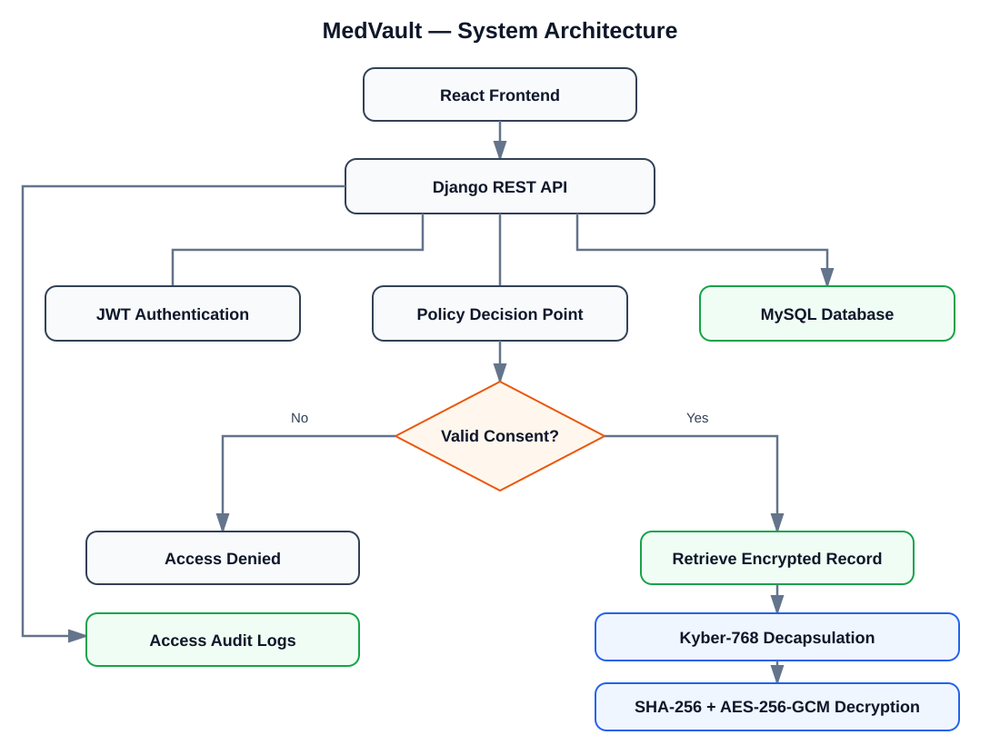

# 🔐 MedVault – Secure Patient Medical Record System

### Hybrid Post-Quantum Encryption | Policy-Based Access Control | Secure Medical Record Management

MedVault is a secure web-based medical record management system designed to protect sensitive patient information while enabling controlled sharing of medical records between patients and authorized doctors.

The system combines **Kyber-768 Post-Quantum Key Encapsulation, AES-256-GCM Encryption, SHA-256 Key Derivation, and Policy-Based Access Control** to provide confidentiality and controlled access to medical records.

A key implementation decision was using an **Ubuntu Linux environment** for backend development and execution because certain cryptographic dependencies, particularly Open Quantum Safe's `liboqs` library and its Python bindings, presented compatibility and installation limitations on Windows.

---

## 🎥 Project Demo

Watch the complete demonstration of MedVault:

[Click to view MedVault Project Demo](https://drive.google.com/file/d/19mnLinWx6ovoFCxh5jyHMFySSk3t9XtL/view?usp=sharing)

---

## 🚀 Key Features

- **Patient and Doctor Registration:** Separate registration and authentication workflows.
- **Secure Medical Record Upload:** Encrypts medical documents before storage.
- **Hybrid Post-Quantum Encryption:** Combines Kyber-768, SHA-256, and AES-256-GCM.
- **Doctor Authorization:** Patients can grant doctors access to their medical records.
- **Consent Management:** Grant, revoke, and manage doctor permissions.
- **Policy-Based Access Control:** Evaluates consent status and expiration before allowing access.
- **Secure Record Retrieval:** Authorized doctors can retrieve and decrypt medical records.
- **JWT Authentication:** Token-based authentication for protected API endpoints.
- **Access Audit Logging:** Maintains records of patient and doctor medical-record viewing activities.

---

## 🏗️ System Architecture

The application follows a frontend-backend architecture.



### Architecture Components

| Component | Responsibility |
|---|---|
| React Frontend | User interface for patients and doctors |
| Django REST Framework | Backend APIs and application logic |
| Users App | Registration, authentication, and user management |
| Records App | Medical record upload, storage, and retrieval |
| Consent App | Granting and revoking doctor permissions |
| Crypto Engine | Encryption, decryption, and key management |
| Policy Engine | Evaluating access permissions |
| MySQL | Application and record metadata storage |
| Ubuntu Linux | Backend execution and cryptographic dependency environment |

---

## 🔐 Hybrid Post-Quantum Encryption

MedVault implements a hybrid encryption mechanism to secure medical records.

Instead of directly encrypting large medical files using public-key cryptography, the system uses symmetric encryption for the file and post-quantum cryptography to protect its encryption key.

### Cryptographic Technologies

| Algorithm | Purpose |
|---|---|
| Kyber-768 | Post-quantum Key Encapsulation Mechanism (KEM) |
| SHA-256 | Derivation of the key-encryption key |
| AES-256-GCM | Medical file encryption and AES key wrapping |

### Encryption Workflow

1. A patient uploads a medical document.
2. The system generates a random 256-bit AES key.
3. The medical document is encrypted using AES-256-GCM.
4. Kyber-768 encapsulation is performed separately for each authorized doctor.
5. The resulting shared secret is processed using SHA-256 to derive a key-encryption key.
6. The patient's AES file-encryption key is wrapped using AES-256-GCM with the derived key.
7. The encrypted medical document and doctor-specific encrypted key material are stored.

### Decryption Workflow

1. A doctor requests access to a patient's medical record.
2. The Policy Decision Point verifies whether the doctor has valid consent.
3. If access is authorized, the doctor-specific encrypted key material is retrieved.
4. Kyber-768 decapsulation reconstructs the shared secret using the doctor's private key.
5. SHA-256 derives the key-encryption key.
6. AES-256-GCM decrypts the wrapped file-encryption key.
7. The recovered AES key decrypts the medical document.

### Why Hybrid Encryption?

- AES-256-GCM efficiently encrypts large medical files.
- Kyber-768 provides post-quantum protection for the key encapsulation mechanism.
- SHA-256 derives the key used to protect the AES file-encryption key.
- Doctor-specific key material supports controlled sharing without encrypting the entire medical file separately for every doctor.

---

## 🛡️ Policy-Based Access Control

MedVault implements consent-based authorization using a **Policy Decision Point (PDP)**.

### Consent Management

- Patients can grant doctors access to their medical records.
- Consent includes an expiration duration.
- The system maintains the active status and expiration timestamp of consent.
- Patients can revoke previously granted consent.

### Access Evaluation

Whenever a doctor requests a medical record, the Policy Decision Point checks:

1. Does a consent record exist for the patient-doctor relationship?
2. Is the consent currently active?
3. Has the consent expired?

Access is granted only when consent is active and has not expired.

Revoking consent changes its active status, preventing subsequent access through the application's authorization workflow.

---

## 📋 Access Audit Logging

MedVault maintains access audit logs for medical-record viewing operations.

The audit log captures information such as:

- User performing the action
- Medical record accessed
- Action performed
- Purpose of access
- IP address
- Timestamp

This provides traceability for medical-record viewing activities.

---

## 🧰 Technology Stack

| Layer | Technologies |
|---|---|
| Frontend | React 19, JavaScript, Vite |
| Backend | Python, Django 5.2, Django REST Framework |
| Database | MySQL |
| Authentication | Simple JWT |
| Post-Quantum Cryptography | Kyber-768 |
| Hashing / Key Derivation | SHA-256 |
| Symmetric Encryption | AES-256-GCM |
| Cryptographic Library | Open Quantum Safe (`liboqs`) |
| API Communication | Axios |
| Development Environment | Ubuntu Linux |

---

## 🐧 Development Environment – Ubuntu Linux

Ubuntu was used as the backend development and execution environment because certain cryptographic libraries required by the project had compatibility and installation limitations on Windows.

In particular, the Open Quantum Safe `liboqs` library and its Python bindings were configured in Ubuntu to support Kyber-768 integration.

### Why Ubuntu?

- Better compatibility with the native cryptographic dependencies used in the project.
- Support for building and configuring the `liboqs` library.
- Easier integration of the required Python cryptographic bindings.
- A suitable Linux environment for running and testing the Django backend.

The Django backend and cryptographic operations were executed in Ubuntu, while the React frontend was developed using Node.js and Vite.

---

## 📁 Project Structure

```text
MedVault/
│
├── docs/
│   └── medvault-system-architecture.svg
│
├── frontend/
│   ├── src/
│   │   ├── components/
│   │   ├── pages/
│   │   └── ...
│   ├── package.json
│   └── vite.config.js
│
├── backend/
│   ├── backend/
│   │   ├── settings.py
│   │   └── urls.py
│   │
│   ├── users/
│   ├── records/
│   ├── consent/
│   ├── crypto_engine/
│   ├── policy_engine/
│   │
│   ├── manage.py
│   └── ...
│
├── README.md
└── .gitignore
```

---

## ⚙️ Installation and Setup

### Prerequisites

- Ubuntu Linux
- Python 3.10+
- Node.js and npm
- MySQL Server
- Git
- Open Quantum Safe `liboqs` library
- Python bindings for `liboqs`

### 1. Clone the Repository

```bash
git clone YOUR_GITHUB_REPOSITORY_URL
cd MedVault
```

### 2. Configure the Cryptographic Environment

Install and configure the Open Quantum Safe `liboqs` native library and its Python bindings in Ubuntu.

Ensure that the native library and Python bindings are correctly configured before starting the backend.

Verify that the Python environment can import the required `oqs` module.

### 3. Set Up the Python Environment

```bash
cd backend

python3 -m venv venv
source venv/bin/activate
```

Install the backend dependencies used by the project:

```bash
pip install django
pip install djangorestframework
pip install djangorestframework-simplejwt
pip install django-cors-headers
pip install python-dotenv
pip install cryptography
```

Also install the MySQL Python driver and the required `liboqs` Python bindings.

### 4. Configure Environment Variables

Create a `.env` file using the environment-variable names expected by the backend.

Example:

```env
SECRET_KEY=your_django_secret_key
DEBUG=False

DB_NAME=secure_medical_db
DB_USER=your_database_user
DB_PASSWORD=your_database_password
DB_HOST=localhost
DB_PORT=3306

KEY_VAULT_MASTER_KEY=your_master_key
```

**Important:** Never commit actual credentials, private keys, encryption keys, or secret values to GitHub.

### 5. Configure the Database

Create the MySQL database and configure the database credentials in the backend environment.

Then run:

```bash
python manage.py makemigrations
python manage.py migrate
```

### 6. Start the Django Backend

```bash
python manage.py runserver
```

Backend development server:

```text
http://127.0.0.1:8000/
```

### 7. Start the React Frontend

Open another terminal:

```bash
cd frontend

npm install
npm run dev
```

The frontend will run at the local Vite development URL displayed in the terminal.

---

## 🔗 API Endpoints

### Authentication and User Management

| Method | Endpoint | Description |
|---|---|---|
| POST | `/api/users/register/patient/` | Register a patient |
| POST | `/api/users/register/doctor/` | Register a doctor |
| POST | `/api/token/` | Obtain JWT tokens |
| POST | `/api/token/refresh/` | Refresh access token |
| GET | `/api/users/me/` | Retrieve authenticated user |
| GET | `/api/users/dashboard-stats/` | Retrieve dashboard statistics |
| POST | `/api/users/add-doctor/` | Add a doctor |
| POST | `/api/users/remove-doctor/` | Remove a doctor |

### Medical Records

| Method | Endpoint | Description |
|---|---|---|
| POST | `/api/records/upload/` | Upload a medical record |
| GET | `/api/records/patient-records/` | Retrieve patient records |
| GET | `/api/records/doctor-records/` | Retrieve accessible doctor records |
| GET | `/api/records/view/<id>/` | Doctor views a medical record |
| GET | `/api/records/patient/view/<id>/` | Patient views their own record |

### Consent Management

| Method | Endpoint | Description |
|---|---|---|
| POST | `/api/consent/grant/` | Grant doctor consent |
| POST | `/api/consent/revoke/` | Revoke doctor consent |
| GET | `/api/consent/my-doctors/` | Retrieve associated doctors |

Protected endpoints require JWT authentication.

---

## 🔮 Future Enhancements

- Integration with additional post-quantum cryptographic algorithms.
- Improved key lifecycle management and secure key storage.
- Comprehensive audit logging for uploads, consent changes, and other sensitive operations.
- Secure cookie-based authentication using HttpOnly cookies.
- Production-ready deployment configuration and security hardening.
- Cloud-based encrypted medical record storage.
- Enhanced monitoring and security event detection.

---

## 🎯 Project Objective

The primary objective of MedVault is to explore how post-quantum cryptography and policy-based authorization can be combined to build a secure medical record management system.

The project demonstrates practical implementation of:

- Post-quantum key encapsulation.
- Hybrid encryption.
- Secure key management.
- Consent-based access control.
- REST API development.
- Linux-based cryptographic dependency configuration.

**Note:** MedVault is an academic project implementation and has not been independently certified for production healthcare deployment or regulatory compliance.

---

## 👩‍💻 Author

**Sanjana Manne**

B.Tech – Computer Science and Engineering

GitHub: https://github.com/SanjanaManne70/
